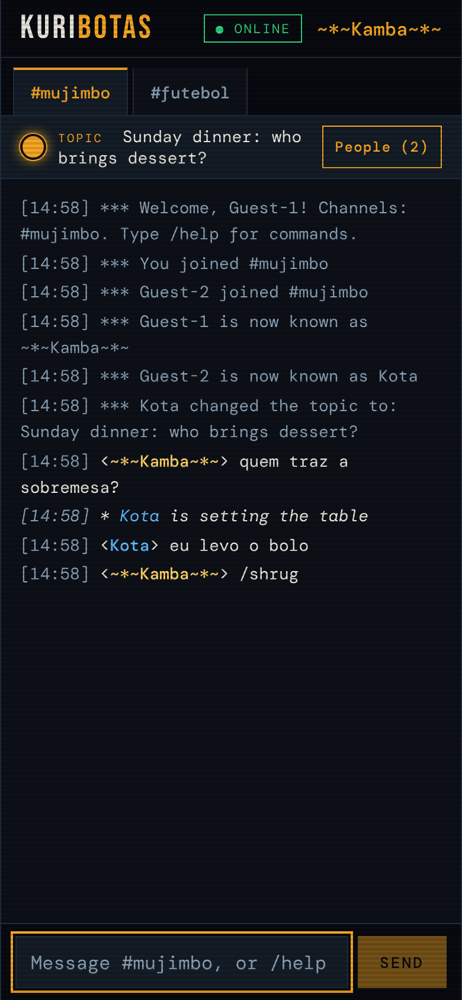
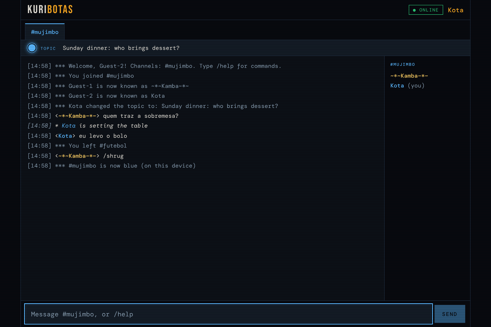

# Kuribotas

**A real-time chat for family and friends — the child of 2000s IRC and instant messengers, rebuilt for the phone.**

*Kuribota* is Angolan slang for the person who always knows everyone's business. Our main channel is `#mujimbo` — the rumour that travels from mouth to mouth.

> Status: ✅ **live on AWS since 6 Nov 2026** behind a Cloudflare Tunnel, with nightly backups, a backup alarm and a load test behind it; the family chats on it every day. Polish after launch done (two styles, history and `/log`, help inside the app, December fun). Next: passkeys and a knock at the door. **[Case study](docs/case-study.md)**: what was built, the decisions and the numbers.

## What it is

From IRC: channels with topics, slash commands (`/me`, `/nick`, `/topic`, `/msg`, `/invite`), a nick list with `@` and `+`, coloured nicks, timestamps and `*** Mum joined #mujimbo`.

From instant messengers: a contact list with statuses (**Na bardea**, **Já vorto**, **No biolo**, **A zongolar** — invisible), a personal message, "is typing…", private chats and the nudge that shakes the screen.

New: it is a **PWA** — open an invite link, add it to the home screen, get push notifications. No app store, no passwords.

## Screenshots

  
  

*Made-up nicks and messages. Left: a Portuguese phone in the dark theme, typing `ko` and being offered **Kota**. Right: the same chat on an English desktop in the light theme, with Kota's row tapped open in the people list.*

## Status

| # | Phase | Hours (est.) | Status |
|---|---|---|---|
| 0 | Foundations: repo, TypeScript monorepo, CI → GHCR, Dependabot | 3–4 | ✅ |
| 1 | Basic chat: WebSocket server, channels, SQLite history, slash commands, retro UI | 7–10 | ✅ |
| 2 | Messenger side: statuses, private chats, nudge and tornado, typing, family sounds, the arsenal (chinela, vassoura, Maria das Dores, batuque), emoji bar | 6–9 | ✅ (~7 h) |
| 3 | Phone without effort: PWA, Web Push, reconnection, unread counts | 5–7 | ✅ (~3 h 30) |
| 4 | Invites and security: invite links, sessions, roles, rate limits | 3–5 | ✅ (~1 h 20) |
| 5 | Deploy: AWS EC2 t4g.nano (Terraform) + Cloudflare Tunnel, no inbound ports; nightly backups + alarm, load test | 4–7 | ✅ (~5 h) |
| 4b | After launch: two styles, drawn icons, history and `/log`, group invites, `/roll`, `/8ball`, December `/neve`, private chats kept 3 days, help inside the app (stickers dropped) | 2–4 | ✅ (~4 h) |
| 6 | Write-up: [case study](docs/case-study.md) | 2–3 | ✅ |

MVP: 28–42 h. 4b was planned right after accounts and moved after launch on purpose: a live app for the family came first.

## What is built so far

- **TypeScript monorepo** with npm workspaces: `server/`, `web/` (Preact, bundled by esbuild) and `shared/` (the chat protocol both sides use).
- **No build step:** Node 26 runs `.ts` files directly by stripping types; `tsc` runs as a type checker only (`erasableSyntaxOnly`, `strict`).
- **One command for quality:** `npm run check` = type check + ESLint + tests (Node's built-in test runner).
- **Server:** one port for HTTP and WebSocket. `GET /healthz` → `200 {"status":"ok"}`, `GET /push/key` → the server's public key for notifications, other paths `404`; WebSocket upgrades only on `/ws`. Graceful shutdown on `SIGTERM`: chat clients get close code 1001, stragglers are force-closed after 3 s.
- **Real-time chat:** `ws` (zero dependencies). Everyone arrives with their account's nick and can change it (`/nick`; it belongs to one person, ignoring case); anyone creates a channel by joining it; messages, members, history and topic are per channel; `/me` actions; join, part, quit and nick events; errors go only to whoever caused them. Requests are checked for shape, then for meaning, and a database failure never kills a connection. Tested with Node's built-in WebSocket client, the same API browsers use.
- **History (SQLite):** Node's built-in `node:sqlite` (no native module). Schema `spaces` → `channels` → `messages`, upgraded by numbered migrations tracked in `PRAGMA user_version`, each in a transaction (seven so far: v2 added the author and `say`/`me`, v3 the devices that asked for notifications, v4 people, sessions and invites, v5 which session each notification belongs to, v6 private and home rooms and each person's memberships, v7 private messages between two people); a test upgrades a real version-1 database. WAL mode; prepared statements only (no SQL injection). A message is saved before it is broadcast; newcomers get the last 50. **Channel messages are kept for 90 days** (the family's choice: the gossip doesn't stay around for long): private ones (DMs and private rooms) for **3 days**. Older ones are deleted when the server starts and then every hour (`historyDays` and `privateDays` in `createApp`, 0 = keep everything). Data lives in `DATA_DIR` (default `./data`, `/data` in the image, mounted as a volume).
- **Web client:** Preact (React's API in ~4 KB) bundled by esbuild into a 22 KB script. Slash commands (`/nick`, `/join`, `/part`, `/me`, `/topic`, `/colour`, `/help`) become protocol messages; all screen state lives in one pure reducer, tested without a browser. Channel tabs with unread counts, topic bar, people list, `***` events, 24-hour timestamps. Dark theme; each channel has a colour, chosen per device. Open-licence fonts ship with the app. Messages are always rendered as text, never as HTML. Tested on two phones and two desktop browsers.
- **A calmer chat for phones:** type the start of a nick (`Ko`, or `@k`) and the names that fit appear above the box: tap one (or press Tab) and it becomes `Kota: ` at the start of a message, `Kota ` or `@Kota ` anywhere else. `/entradas nao` (`/joins off`) hides the *chegou / saiu* lines on a device, since a phone locking and unlocking comes and goes all day; the people list stays right. The first tab is a folded **⚙️ ›**: tap it and it opens into **💡 Dicas** and **Definições** (tap ‹ to fold it away). Dicas sits before the channels: practical help in sections (chatting, status, nudges and the arsenal, private, phone, for @), and tapping a tip with a command puts it in the box, ready to try. It is part of the app, not a channel: it never expires and never mixes with the chat. **Definições** holds this device's choices as buttons (look, arrived/left lines, nudges, nudge and tornado sounds with ▶ to listen, notifications, language): each button runs the same command a person could type, so there is one way every choice works.
- **`/neve`** ❄️ (`/snow`): snow falls on everyone's screen in the room for 7 s and melts away (white on dark, winter blue on light), with the line "Kota fez nevar no #mujimbo". Not saved, one a minute per person, same off switches as the big emoji.
- **`/roll` and `/8ball`** 🎲🎱: `/roll` throws a 6-sided die (`/roll 20` or `/roll d20`: 2 to 100 sides; `/dado`), `/8ball <pergunta>` asks the magic ball (`/bola`), which answers in the family's words ("Confirmado, kota", "Pergunta à tua mãe", "Nem pensar"…). The server throws and shakes, so nobody picks their own luck; the whole room sees the line; not saved; one every 5 s per person. Every new command also gets a tip in 💡 Dicas, in both languages (a test checks it).
- **History and `/log`**: scroll to the top of a room and the next 100 older messages load above, keeping your place, until the line "Início do que está guardado" (90 days; 3 in a private room); a day line marks where the date changes. `/log` downloads the room's saved conversation as a text file, mIRC style (`[2026-11-01 08:01] <Kota> olá`), made on the phone (nothing is written on the server; one every 30 s).
- **Drawn icons** on the buttons (the menu's gear, Dicas, the pencil, the emoji button, private chats, locked rooms, privado, abanar, tornado): `web/src/icons.tsx`, plain SVG lines in the button's own colour, so they look the same on every phone; emoji stay where they are the content (the emoji bar, the big emoji, the status list).
- **Two styles** per device: `/estilo mirc | moderno` (`/style`) or the buttons in ⚙️ Definições. mIRC is the classic log (`[18:41] <Kota> olá`); moderno is a round badge with the person's initials, name and time above the text, the next messages from the same person grouped under it, the phone's own font, round room chips and a pill-shaped message box. Both work with dark and light (moderno + escuro is "Noite", moderno + claro is "Dia", with underlined room names).
- **Big emoji** 😂: a message that is only one of nine emojis fills the screen of everyone in the open room for 1.8 s, does its move and goes: 😂 🤣 shake with laughter and roll away, 😭 sobs with falling tears, ❤️ beats three times, 🔥 flickers and burns out, 👏 🙌 clap, 😡 swells up red, 😱 jumps back, 🇦🇴 waves, 🎉 spins and throws confetti. Live messages only, at most one every 4 s, off with `/abanoes nao` and for phones set to reduce motion; drawn with the emoji and CSS, and the message stays in the chat as a normal line.
- **Club flags** 🚩: `/bandeira benfica | porto | sporting | madrid | barca` (also `slb`, `fcp`, `scp`, `real`, `barça`; `/flag` in English) sweeps a giant flag in the club's colours across everyone's screen in the room, waves and leaves: **SLB** on red with an eagle swooping over it, **FCP** on blue and white stripes with a blue dragon rising, **SCP** on green and white with a roaring lion, **¡HALA MADRID!** in purple on white, **BARÇAAAAAA** on blaugrana stripes. Colours, words and plain emoji only: no club crests (they are trademarks). One flag every 20 s per person, not saved, same off switches as the big emoji.
- **Kamba Oculto** 🎅: the family's secret-friend draw. Each adult gets a code; `/kamba <code>` (`/amigooculto`) opens their envelope on their own device: who they give to, and who their children give to. The code is never sent to the room or the server, the line is shown only to them, and the repo holds only the sealed envelopes (AES-GCM, key from the code with PBKDF2). The draw was made blind, so nobody has seen the whole list.
- **Two looks, one layout:** a dark IRC terminal and a light, crisp mIRC window, both drawn from the same CSS custom properties. `/tema escuro | claro | auto` (`/theme dark | light | auto`) picks one per device; **auto** (the default) follows the phone's light or dark setting, applied before anything is drawn so the door opens in the right colours too. Every colour reaches 4.5:1 contrast in both themes, messages are 15 px with IRC-style wrapping (under the text, never under the time), and the people list opens a person's actions (privado · abanar · tornado) only when you tap their name. The corner symbol is the **puzzle logo** (KURI / BOTAS tiles) on a computer and the **peeker** on a phone and on the door.
- **Statuses, MSN style, in the family's own words:** 🟢 **Na bardea**, 🟡 **Já vorto**, 🔴 **No biolo**, 👻 **A zongolar** (invisible: to everyone else it looks exactly like leaving; coming back looks like arriving). Choosing a status picks a random caption (*No biolo · a fingir que trabalho*), or you write your own line (up to 80 characters). The app speaks Angolan Portuguese by default (`/lingua en` switches a device to English); every word lives in one file, `web/src/words.ts`, so the family's jokes change without touching code. Server errors carry a code, so each screen says them in its own language.
- **"is typing…"**: a quiet line above the message box (*Kota está a escrever…*, *Kota e Kamba-2 estão a escrever…*). It clears when the message arrives, when the box is emptied, or 6 s after the last keystroke. Typing a command doesn't count, invisible people never show, and none of it is saved or logged. The server passes it on at most every 2 s per person and channel.
- **The nudge (abanão)** 📳: `/abanar Kota`, or the 📳 beside a name, shakes Kota's screen, plays pots falling in the kitchen with a lid left spinning on the floor and vibrates Android phones; the whole channel sees *Kota abanou Kamba!*. Up to 3 quick nudges, then a pause. For special occasions, `/tornado Kota` 🌪️ shakes harder and harder for 2.5 s to a batucada with heavy bass that drops into a kuduro beat, one a minute. `/abanar todos` shakes the whole channel (once a minute) and `/tornado todos` sends everyone a tornado (once every 5 minutes). Every sound is made in code (Web Audio): no audio files, nothing recorded or copied. **No biolo** gets the shake without sound or vibration, `/abanoes nao` switches nudges off on a device, phones set to reduce motion get a flash of colour instead, and invisible people can neither nudge nor be found by a nudge. Nudges are not saved.
- **The family arsenal** 🩴🧹🥄🥁: `/chinela Kota`, `/vassoura Kota` and `/mariadasdores Kota` (`/colher`) throw a chinela, a broom or the Maria das Dores, Angola's wooden spoon (drawn in SVG: the 🥄 emoji is metal), across the channel: everyone sees it fly, Kota gets **PÁ!**, **XÔ!** or **TOC!**, a jolt and the sound. `/batuque` makes everyone's screen pulse to a kuduro beat. Up to 3 throws per 10 s and one batuque a minute; No biolo stays silent, `/abanoes nao` turns the animations off, phones set to reduce motion only get the line, and invisible people can't throw. Drawn with emoji and CSS, sounds made in code, nothing saved.
- **Installable as an app** 📱: our own icon, from a family sketch (then polished): someone peeking over the wall with a side-eye, the spirit of *A zongolar*. Inside the app the same little one shows while there's no connection and in place of your status dot when you're invisible, its eyes looking around (still, for phones set to reduce motion), opens full screen without the browser bar, and opens even without network (a service worker keeps the app's files; the chat then waits for the connection). Unread messages show in the title, *(3) Kuribotas*, and on the app's icon where the phone allows it; while the app is in the background, messages in the open tab count too. Installing needs https, so on the family's phones it arrives with phase 5 (on a computer, `http://localhost:3000` already works): Android → Chrome menu → *Install app*; iPhone → Share → *Add to Home Screen*.
- **It reconnects by itself** 🔌: when the network drops (a train, a locked phone, a server restart) the app says *Ligação perdida. A voltar a ligar…* and tries again after 1 s, 2, 4… up to 30 s, and at once when the phone gets its network back or the app comes back to the screen. It comes back as the same person, with the same status and phrase, in the same channels, keeping what was on screen and adding the messages missed meanwhile. Private channels can't be rejoined (the invite belonged to the old connection), so their tabs close with a note. The server pings every connection every 25 s and drops the ones that don't answer, so a dead phone doesn't look online. If the device was signed out meanwhile, it goes back to the door instead of trying forever.
- **Only by invite** 🚪: nobody gets in without an invite link. An @ makes one (the very first @ on the server's console: `node server/src/invite.ts --admin`); it works **once, for 7 days**. Opening it shows *Bem-vindo ao Kuribotas!* and asks for a nick, which then **belongs to that person**, online or not. Without an invite you see the door (*Só com convite*) and the chat refuses the connection. No passwords: each device keeps a session in a cookie the page's own scripts can't read (`HttpOnly`, `SameSite=Strict`, `Secure` on https) that lasts a year and is renewed every time the app opens. The database keeps only SHA-256 hashes of invite and session tokens, so a copy of it can't be used to sign in, and the link's token sits after `#`, which browsers never send to the server (so it's in no log). One person on two devices (phone and computer) is **one person** to everyone else: listed once, one *chegou*, one *saiu* when the last device closes; DMs, nudges and status follow you to every device. Limits (3 nudges per 10 s, 1 tornado a minute, 20 messages per 10 s against a stuck key or a script…) belong to the person, so a reload doesn't reset them. The chat and the account API only accept requests from our own page (`Origin` checked: another site can't use your cookie), invite attempts are limited to 20 per 10 minutes per address, and signing a device out closes its chat at once.
- **Invites, devices and the @, from the chat** 🎟️: an @ types `/convite` and gets a link for one new person (copied, ready to paste into WhatsApp; shown only on their own screen), or `/convite 5` for five numbered links at once, one per person (up to 10, all copied). `/aparelho` on your phone gives a link **and a code** like `GSEU-BZCN` for your computer (10 minutes, once); an @ types `/aparelho Kota` to get Kota back in after a lost sign-in (a cleared phone, an invite opened inside WhatsApp), and the invite page tells people to open it in Chrome or Safari before entering: open the link, or type the code at the door. The code is there for the iPhone, where an app added to the home screen doesn't share Safari's sign-in. Codes skip look-alike letters (no 0/O, 1/I), and every lookup counts against the 20-tries limit. `/aparelhos` lists your devices (*Android · Chrome · entrou 6 nov · visto hoje*), `/xau` signs this one out, `/xau 2` signs out another (a lost phone: its session ends, its chat closes and **its notifications stop**). An @ shows as `@Nick` in the people list; `/op Kota` and `/deop Kota` give and take @ (you can't drop your own, so there's always one), and `/expulsar Kota` removes someone from Kuribotas: account, devices, invites and notifications (their messages stay in the history; an @ has to lose the @ first). English: `/invitelink`, `/device`, `/devices`, `/logout`, `/kick`.
- **Rooms that stay** 🏠: every room is saved, private ones (🔒) too: hidden from the list, with no saved messages, open only to their members. Each person's rooms **reopen on every connection**, so a phone locking (which drops the connection) or closing the app no longer throws anyone out, and a 🔒 room no longer vanishes when everyone is offline; `/bazar` is what ends a membership (the last member out of a 🔒 room takes it along). **Home rooms** are the ones everyone is in, newcomers too (`#mujimbo` always; an @ adds more with `/principal #angola`, `/principal -#angola` takes it off). `/salas` lists the rooms (🏠/🔒, how many are in, the topic); an @ deletes one with `/apagar #sala` (asks for `/apagar #sala sim` if it has messages; never a home room). English: `/rooms`, `/home`, `/delete`.
- **Notifications** 🔔: `/notificacoes sim` (`/notifications on`) asks the browser for permission and from then on this device gets told, even with the app closed, when someone writes your nick in a channel (*Kota · #mujimbo*: the message, at most one every 20 s) or nudges, tornados or throws something at you (*📳 Kota abanou-te!*, *🩴 Chinelada de Kota!*). Only while you're away: if the app is open somewhere, nothing pops up; **No biolo** keeps it quiet; `/notificacoes nao` stops it on that device. Private chats don't notify (they aren't saved, so there'd be nothing to open). Standard Web Push, written with Node's own crypto (no dependency) and checked byte for byte against the example in RFC 8291: each notification is encrypted for that one device, so the push service (Google, Mozilla, Apple, Microsoft) only carries it; the server signs with its own key (VAPID), created on first start in `DATA_DIR/vapid.json` (private, mode 0600, back it up with the database). Only those four push services are accepted as addresses, devices the service has forgotten are removed, and logs carry the status code, never the text. Needs https like installing, so on the family's phones it arrives with phase 5; on an iPhone, install the app first.
- **Little comforts**: the pencil beside the status opens a box for the line under your name (no need to know `/frase`), and each person in the list has privado (private chat), abanar (nudge) and tornado. The smiley beside the message box opens the family's emoji bar (the list lives in `web/src/emoji.ts`).
- **Private chats** 💬🔒: `/msg Kota olá` (or the 💬 beside a name) opens a private chat tab with one person; `/privado #primos` makes a private channel and `/invite Kota` lets someone in. **Private messages are kept for 3 days** (the family's choice; channels keep 90): a DM is saved between the two people (by account, so a new nick keeps the thread) and reaches them even if they're away; opening the tab brings back the conversation, and chats with messages in the last 3 days reopen as tabs when the app opens. What's said in a private channel is saved with it, so someone invited later sees what came before. Private text never goes into a notification. A private channel itself stays, with its members (see *Rooms that stay*). Private channels don't show in the channel list; anyone else trying `/join #primos` is told to ask for an invite. Writing to someone invisible looks exactly like writing to someone away, so a DM never gives them away; invites still need them visible. Inside a 💬 tab, `/abanar` and `/tornado` go to that person and "is typing…" works, MSN style.
- **Family sounds** 🔊: a family server can swap in its own sounds without them ever reaching GitHub. Put MP3s in the server's private data folder (`data/sounds/`, or `/data/sounds` on the Docker volume): `nudge.mp3` and `tornado.mp3` (the defaults), plus `nudge-<name>.mp3` and `tornado-<name>.mp3` (extras) (the tornado shakes for as long as it plays). Each device picks its own with `/som` (lists the options), `/som 3` or `/som panelas` for the pots, and `/som tornado amapiano` or `/som tornado batucada` for the tornado. Only those file names are served, and anything missing falls back to the sounds made in code. **Don't commit sound files you didn't make**: the public repo and image only carry original sounds.
- **Serving it:** the same server serves `web/dist` with a strict Content Security Policy (only our own scripts, styles and WebSocket; nothing from third parties) and path-traversal protection, tested with `../`, `%2e%2e` and `%2f` tricks.
- **Container image:** `ghcr.io/rugerious/kuribotas/server` (tags `sha-<commit>` and `latest`), for `linux/amd64` and `linux/arm64` (the server is an AWS Graviton instance), built in two stages: the first bundles the web client with esbuild, the second holds only the server, its runtime dependencies and the built files. Base `node:26-slim` pinned by digest, runs as the unprivileged `node` user, Docker `HEALTHCHECK` on `/healthz`, stops gracefully in under a second.
- **CI (GitHub Actions):** every PR runs `npm ci`, `npm run check`, a production `npm audit` and an image build; merges to `main` push the image to GHCR. Every action is pinned to a full commit SHA, and runners to `ubuntu-24.04`. Dependabot proposes npm, Actions and Docker updates weekly.
- **Safety from day one:** pre-commit hook for project-specific values, `.gitignore` for secrets and the chat database, GitHub secret scanning + push protection, Dependabot security updates; npm `allowScripts` denies install scripts (esbuild's included, the build works without it), so no dependency runs code when installed.
- **Dependency audit:** production tree clean (`npm audit --omit=dev`). One moderate, dev-only advisory (`minimatch` via ESLint) is accepted until upstream ships a fix: the patterns it parses are our own, and the suggested fix would downgrade ESLint a major version.

### Repo layout

~~~
server/            Node.js + TypeScript backend
  src/app.ts       builds the HTTP server
  src/index.ts     starts it (HOST, PORT)
  src/chat.ts      WebSocket chat on /ws
  src/store.ts     SQLite: schema, migrations, messages
  src/push.ts      Web Push: encryption (RFC 8291) and VAPID signing (RFC 8292)
  src/auth.ts      invites, sessions, the /api routes
  src/invite.ts    makes an invite link on the console (the first @)
  src/static.ts    serves the built web client (CSP, no path tricks)
  test/            node:test tests
shared/            protocol types used by server and web
web/               web client: Preact + esbuild
  src/commands.ts  slash commands → protocol messages
  src/state.ts     all screen state, one pure reducer
  src/words.ts     everything the app says (Angolan Portuguese + English)
  src/gate.tsx     the door and the welcome page (before the chat)
  src/app.tsx      the screens
  build.ts         bundles into web/dist (git-ignored)
.githooks/         pre-commit hook
tsconfig.json      shared type-check settings
eslint.config.js   lint rules
Dockerfile         server image
deploy/            the server's compose file (app + Cloudflare Tunnel), its .env template, and
                   server/: deploy.sh, the nightly backup.sh and its systemd timer
infra/             Terraform: the state bucket (bootstrap/) and the AWS server (server/); see infra/README.md
.github/           CI workflow, Dependabot, PR template
~~~

### Chat protocol (so far)

WebSocket at `/ws`, JSON text frames with a `type` field. The web client turns slash commands into these messages; the server never parses typed text.

**Client → server**

| Message | Slash command | Rules |
|---|---|---|
| `{"type":"nick","nick":"Rita"}` | `/nick Rita` | 1–24 letters, digits or `_-~*^.\|[]{}`; belongs to one person, ignoring case, online or not; saved |
| `{"type":"join","channel":"#futebol"}` | `/join #futebol` | creates the channel if needed; `#` + 1–32 letters, digits, `_` or `-`; stored in lower case |
| `{"type":"part","channel":"#futebol"}` | `/part` | leave a channel |
| `{"type":"say","channel":"#mujimbo","text":"…"}` | plain text | channels you have joined; 1–2000 characters |
| `{"type":"me","channel":"#mujimbo","text":"waves"}` | `/me waves` | same rules as `say` |
| `{"type":"topic","channel":"#mujimbo","topic":"…"}` | `/topic …` | up to 200 characters; empty clears it |
| `{"type":"status","status":"busy","note":"…"}` | `/biolo [note]` (`/bardea`, `/vorto`, `/zongolar`) | `online`, `away`, `busy` or `invisible`; note up to 80 characters |
| `{"type":"typing","channel":"#mujimbo","typing":true}` | typing in the box (sent by the UI) | `true` at most every 3 s while typing, `false` when the box empties or a command is sent |
| `{"type":"nudge","channel":"#mujimbo","nick":"Kota","tornado":false}` | `/abanar Kota` (`/tornado Kota`, or the 📳 button) | someone in that channel; 3 nudges per 10 s, 1 tornado per minute; refused while invisible |
| `{"type":"nudge","channel":"#mujimbo","everyone":true,"tornado":false}` | `/abanar todos` (`/tornado todos`) | the whole channel; 1 group nudge per minute, 1 group tornado per 5 minutes |
| `{"type":"nudge","to":"Kota","tornado":false}` · `{"type":"typing","to":"Kota","typing":true}` | `/abanar` and typing in a 💬 tab | the person must be online and visible; the usual nudge limits |
| `{"type":"msg","to":"Kota","kind":"say","text":"olá"}` | `/msg Kota olá`, or typing in a 💬 tab | anyone with an account, online or not; kept 3 days |
| `{"type":"dm_history","with":"Kota"}` | opening a 💬 tab | the saved private messages with that person (last 100) |
| `{"type":"join","channel":"#primos","private":true}` | `/privado #primos` | a name that isn't a public channel; its messages are kept 3 days |
| `{"type":"throw","channel":"#mujimbo","item":"chinela","nick":"Kota"}` | `/chinela Kota` (`vassoura`, `colher`; `batuque` has no nick) | someone visible in the channel; 3 throws per 10 s, 1 batuque per minute; refused while invisible |
| `{"type":"invite","channel":"#primos","nick":"Kota"}` | `/invite Kota` | you're in the channel; they're online, visible and not already in |
| `{"type":"make_invite","count":5}` | `/convite` (`/convite 5`) | @ only; 1–10 links (no `count` = 1); answered with `link`, or `links` for several |
| `{"type":"make_device_link","nick"?}` | `/aparelho` · `/aparelho Kota` | a code for your own other device, or (an @ only) for someone who lost their sign-in; answered with `link` (a code, `for` = whose) |
| `{"type":"devices"}` · `{"type":"forget_device","id":2}` | `/aparelhos` · `/xau 2` | your devices; forgetting one ends its session and its notifications |
| `{"type":"role","nick":"Kota","role":"admin"}` | `/op Kota` · `/deop Kota` | @ only; not your own @ |
| `{"type":"remove","nick":"Kota"}` | `/expulsar Kota` | @ only; not another @ |
| `{"type":"rooms"}` | `/salas` | answered with `rooms` |
| `{"type":"home","channel":"#angola","on":true}` | `/principal #angola` · `/principal -#angola` | @ only; a public room; `#mujimbo` always stays |
| `{"type":"delete_room","channel":"#teste","confirm":false}` | `/apagar #teste [sim]` | @ only; not a home room; `confirm` needed if it has messages |
| `{"type":"push","subscription":{"endpoint":"https://…","keys":{"p256dh":"…","auth":"…"}},"lang":"pt"}` | `/notificacoes sim` (sent again on every reconnect) | the browser's push subscription for this device, kept with your nick, public channels and status; `subscription: null` (`/notificacoes nao`) forgets it |

**Server → client**

| Message | When |
|---|---|
| `welcome` `{nick, role, channels}` | on connect: your account's nick, `admin` (@) or `member`, and the channel list |
| `joined` `{channel, topic, members: [{nick, status, note, role}], history, private}` | you joined a channel (everyone lands in `#mujimbo`); history = last 50 messages (none in a private channel) |
| `join` / `part` `{channel, nick}` | someone joined or left a channel you are in |
| `quit` `{nick}` | someone who shares a channel with you disconnected |
| `nick` `{old, nick}` | someone changed nick |
| `topic` `{channel, topic, nick}` | a channel's topic changed |
| `presence` `{nick, status, note}` | someone's status or note changed (`invisible` is only ever sent to yourself) |
| `typing` `{channel, nick, typing}` | someone in the channel started or stopped typing (never to the typer, never from invisible people, never saved) |
| `nudge` `{channel, from, to, tornado}` | someone nudged someone in the channel; only `to` shakes (`to: null` = everyone but `from`). Not saved |
| `nudge` `{dm: true, from, to, tornado}` · `typing` `{dm: true, nick, typing}` | a nudge or typing in a private chat. Not saved |
| `dm` `{id, from, to, kind, text, at}` | a private message, to both sides; saved first (3 days) |
| `dm_history` `{with, messages}` | the saved private messages with someone, oldest first · `welcome.dms` lists recent private chats to reopen |
| `throw` `{channel, from, to, item}` | something flies across the channel; `to` gets hit (`to: null` = batuque, everyone). Not saved |
| `invited` `{channel, from, to}` | an invite, to the invited person and the inviter |
| `message` `{id, channel, nick, kind, text, at}` | a `say` or `me`: saved first, then sent to the channel |
| `link` `{kind, token, expiresAt}` | only to you: a person invite (`#convite=<token>`, 7 days) or a device code (`#aparelho=<code>`, 10 minutes) |
| `devices` `{devices: [{id, name, since, seen, current}]}` | only to you |
| `rooms` `{rooms: [{name, topic, people, home, private}]}` | only to you: public rooms and your 🔒 ones |
| `home` `{channel, on, by}` · `room_deleted` `{channel, by}` | to everyone |
| `role` `{nick, role, by}` · `removed` `{nick, by}` | to everyone: someone got or lost @; someone was removed |
| `error` `{code, detail, reason}` | your last request was refused (only you see it); the client translates `code` |

Anything malformed is ignored. Frames over 16 KiB close that client with code 1009; on shutdown, clients get 1001 ("going away"); a device that signed out gets 4401. Opening `/ws` needs a session cookie (else `401`) and our own page's `Origin` (else `403`).

**Accounts (HTTP, JSON)**

| Request | Answer |
|---|---|
| `GET /api/me` | `200 {nick, role}` and the cookie renewed, or `401 {"error":"no_session"}` |
| `GET /api/invite/<token>` | `200 {"kind":"person"}` or `{"kind":"device","nick":"…"}`; `404 invite_unknown`, `410 invite_used` / `invite_expired` |
| `POST /api/redeem` `{token, nick}` | uses the invite once: `200 {nick, role}` + session cookie; `400 invalid_nick` / `nick_taken`; `429 too_many_tries` |
| `POST /api/logout` | ends this device's session, clears the cookie, closes its chat |

POSTs need `Content-Type: application/json` and our own `Origin` (else `403 forbidden`).

## Architecture

~~~
Phone (PWA) ──HTTPS/WSS──▶ Cloudflare ◀──outbound tunnel── AWS EC2 t4g.nano (no inbound ports)
                                                             ├─ cloudflared (container)
                                                             ├─ Node.js + TypeScript (HTTP + WebSocket, container)
                                                             ├─ SQLite on the instance's encrypted disk
                                                             └─ Web Push (VAPID) ──▶ phone notifications
~~~

## Running it on AWS

`infra/server` builds the whole server with Terraform: its own small VPC, an **EC2 t4g.nano** (Graviton, Amazon Linux 2023) with an encrypted disk, IMDSv2 only and termination protection, a security group with **no inbound rule at all**, an IAM role limited to SSM and the `/kuribotas/*` parameters, and a monthly budget alert. On first boot the instance installs Docker and Compose (pinned, hash-checked) and runs `deploy.sh`: settings from SSM Parameter Store into a `0600` `.env`, `deploy/compose.yaml` from the same commit as the image, then the app and the Cloudflare Tunnel start. The family reaches it through the tunnel; admins through SSM Session Manager (no SSH, no keys). Every night it backs up the database (SQLite's own consistent copy, integrity-checked), the notification keys and the family's sounds to a private, encrypted S3 bucket that the server can only **add** to (35 days kept), and tells CloudWatch it did: 26 hours without that sign (a failed backup, or the server off) emails an alert. A load test on the real t4g.nano, against a throwaway copy of the app, delivered every message to 150 people chatting at 29 messages a second in 3 ms (p99 7 ms) with 37 MB of memory: far above what a family needs, so the smallest instance stays. The state lives in a versioned, encrypted S3 bucket with S3's own locking. Details and the parameters: [infra/README.md](infra/README.md).

## Rules this project follows

- **Zero inbound ports.** The server is reached only through an outbound Cloudflare Tunnel.
- **Family data never leaves the server.** No messages, names or screenshots of real chats in Git, issues, logs or this README. The database and its backups are git-ignored.
- **No secrets in Git.** Runtime secrets live in a `0600` `.env` on the server; `.env.example` documents them.
- **Inspired, not copied.** Features are ideas anyone can use; no names, logos, sounds, emoticons or icons from IRC clients or messengers. All art and sounds are original.
- **Nothing from third parties in the browser.** No analytics, no CDNs, no web fonts from elsewhere; the CSP enforces it.
- **Pinned versions, automated updates** (Dependabot), and every change through a pull request.

## Development setup

Requirements: Linux or WSL2, [nvm](https://github.com/nvm-sh/nvm), Node.js 26 LTS (pinned in `.nvmrc`).

~~~
nvm use                                # use the Node version from .nvmrc
git config core.hooksPath .githooks    # enable the pre-commit hook (once per clone)
npm ci                                 # install exactly what package-lock.json says
npm run check                          # type check + lint + tests
npm run build                          # build the web client into web/dist
npm run dev --workspace server         # run the server, restart on save
curl http://127.0.0.1:3000/healthz     # {"status":"ok"}
node server/src/invite.ts --admin       # an invite link for the first @ (once, 7 days)
# open that link at http://localhost:3000, pick a nick; a private window + another invite = a second person
docker build -t kuribotas/server:dev .                          # build the image
docker run --rm --name kuribotas -p 127.0.0.1:3000:3000 -v kuribotas-data:/data kuribotas/server:dev   # run it, data in a volume
docker exec kuribotas node server/src/invite.ts --admin        # the first @ invite, inside the container
~~~

**Pre-commit hook.** `.githooks/pre-commit` refuses any commit made directly on `main` (every change goes branch → PR → CI → merge), and blocks a commit when the added lines contain a forbidden value: AWS account ID, email, domain or real family names, matched case-insensitively. The values live outside the repo in `~/.config/kuribotas/forbidden-patterns`, so the hook itself reveals nothing. GitHub secret scanning catches known secret *formats*; the hook catches this project's own *values*.

## Licence

[MIT](LICENSE)
